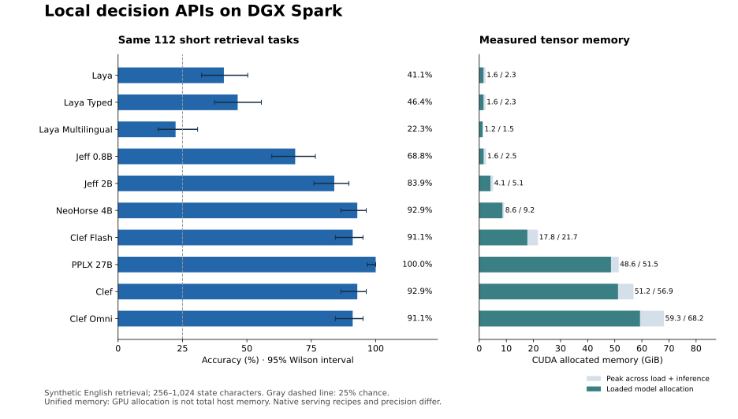
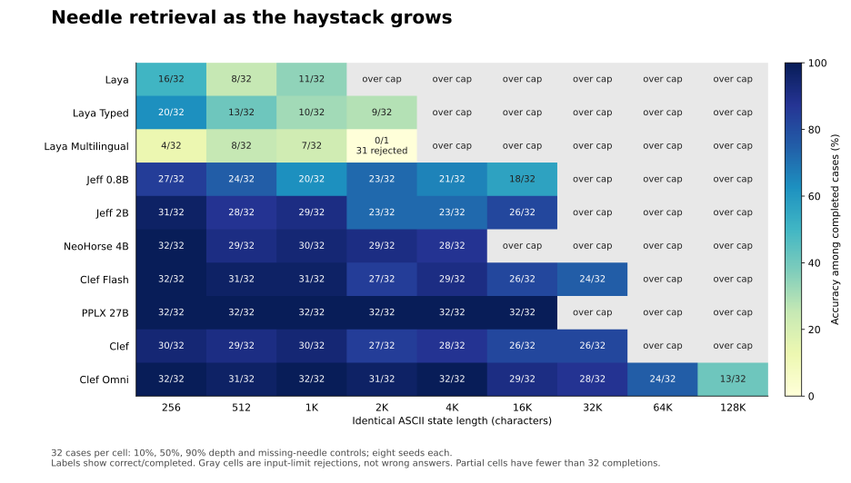

# Local Jev-style APIs on DGX Spark: context, speed, memory and retrieval

Measured 13 October 2026. **10/10 checkpoint deployments complete.** All tests use the same DGX Spark and pinned checkpoint revisions. These are locally hosted deployments; no paid hosted-provider service was benchmarked.

The comparison separates runtime input capacity, retrieval quality and serving speed. A model accepting a long input does not prove it used that input correctly. Oversized requests are rejected explicitly; none of the scored requests are silently shortened.

## Findings to lead with

Ten checkpoints from five publishers were deployed locally on one DGX Spark. The primary comparison contains **3,360 model/case outcomes**: **2,065 completed answers** and **1,295 explicit context rejections**, with no other quality-call failures in the ten selected completed runs. An operator-stopped Omni attempt is retained separately and excluded from those totals. These are synthetic retrieval results, not a general model leaderboard.

- **PPLX 27B had the strongest observed quality on the shared subset:** 112/112 short cases and 224/224 across all cases it could accept. Its native serving cap is 8,192 tokens, with about 48.6 GiB loaded CUDA allocation and a 607 ms repeated short-request median. Its perfect score applies to this corpus and its covered lengths, not arbitrary code review.
- **NeoHorse 4B and Jeff 2B offer smaller-footprint options.** NeoHorse scored 104/112 (92.9%) at 8.55 GiB loaded allocation and 121 ms short median, but its native state budget is only 2,048 tokens. Jeff 2B scored 94/112 (83.9%) at 4.12 GiB and 54 ms. Pick against the required input size and tolerated errors, not parameter count alone.
- **Clef Flash gives a useful speed/context tradeoff, with a major absence caveat.** It scored 102/112 (91.1%) and processed 16,384 tokens at about 17.75 GiB loaded allocation. At 32,768 state characters it found all 24 present needles but answered none of the eight absent-key controls correctly. Clef used about 51.2 GiB and did not consistently improve quality: its long two-hop score was 4/16 versus Flash's 13/16. Flash's short score differs from NeoHorse's by only two answers; their descriptive uncertainty intervals overlap.
- **Omni extends capacity much farther than reliable retrieval.** It accepted every frozen corpus case and processed a 63,999-token boundary probe against a configured 64,000-token cap. Its shared short score was 102/112. At 131,072 state characters (about 60K encoded tokens), one-hop accuracy fell to 13/32: 0/8 near the beginning, 2/8 near the middle, 7/8 near the end, and 4/8 with the key absent. Long two-hop scores were 0/16 at 16,384 characters and 1/16 at 65,536. Eight trials per position are descriptive, not a definitive statistical characterization.
- **A successful load is only part of the memory story.** The tables distinguish loaded tensors, inference peaks, reserved memory and the approximate peak host footprint. Clef's host available-memory drop exceeded 100 GiB during its run despite only about 51 GiB of loaded CUDA tensors. Omni required a documented restart after a CPU-memory retention issue. Leave startup headroom and verify actual inference; do not size the machine from checkpoint file size alone.

For the tutorial, a useful central claim is: **“We tested what fits, how fast it answers, and whether it finds the evidence—including when the evidence is missing.”** Show one pinned local API recipe, then explain the backend/image exceptions and connect the same endpoint contract to Jev CI. Demonstrate the absence and linked-lookup failures alongside successful requests; they are relevant limitations for an evidence-based quality gate.

## Shared short-context comparison

The common short subset is the same 112 frozen cases at 256, 512 and 1,024 ASCII characters: 96 one-hop cases including absent-needle controls, plus 16 two-hop cases. This subset is descriptive; the complete per-length results below should guide any quality claim. Random guessing among four options has 25% expected accuracy. Wilson intervals are descriptive binomial intervals; shared synthetic templates and seeds limit population-level interpretation.

| Checkpoint | Correct / 112 short cases | Wilson 95% interval | Loaded GPU allocation (GiB) | 512-char repeated-input median / p95 (ms) | Strict runtime cap (tokens) |
|---|---:|---:|---:|---:|---|
| Laya | 46/112 (41.1%) | 32.4–50.3% | 1.57 | 22.5 / 23.8 | 512 total/question |
| Laya Typed | 52/112 (46.4%) | 37.5–55.6% | 1.57 | 22.5 / 23.3 | 1,024 total/question |
| Laya Multilingual | 25/112 (22.3%) | 15.6–30.9% | 1.22 | 11.1 / 12.0 | 1,024 total/question |
| Jeff 0.8B | 77/112 (68.8%) | 59.7–76.6% | 1.62 | 40.1 / 40.6 | 8,192 total/question |
| Jeff 2B | 94/112 (83.9%) | 76.0–89.6% | 4.12 | 54.1 / 54.9 | 8,192 total/question |
| NeoHorse 4B | 104/112 (92.9%) | 86.5–96.3% | 8.55 | 120.6 / 121.8 | 2,048 state; 8,192 branch |
| Clef Flash | 102/112 (91.1%) | 84.3–95.1% | 17.75 | 237.2 / 238.8 | 16,384 total/question |
| PPLX 27B | 112/112 (100.0%) | 96.7–100.0% | 48.60 | 606.5 / 608.4 | 8,192 total/question |
| Clef | 104/112 (92.9%) | 86.5–96.3% | 51.19 | 674.4 / 677.3 | 16,384 total/question |
| Clef Omni | 102/112 (91.1%) | 84.3–95.1% | 59.30 | 345.9 / 347.6 | 64,000 total/question |

## Retrieval as the haystack grows

One-hop exact-key retrieval, including near-match distractors and missing-needle controls. Each length has 32 cases: eight seeds at each of 10%, 50%, 90% depth and eight absent-needle controls. Cells show correct/completed; “—” means the runtime rejected every case at that length. Lengths are identical state bytes/characters across models; their full encoded token counts differ.

| Checkpoint | 256 | 512 | 1,024 | 2,048 | 4,096 | 16,384 | 32,768 | 65,536 | 131,072 |
|---|---:|---:|---:|---:|---:|---:|---:|---:|---:|
| Laya | 16/32 | 8/32 | 11/32 | — | — | — | — | — | — |
| Laya Typed | 20/32 | 13/32 | 10/32 | 9/32 | — | — | — | — | — |
| Laya Multilingual | 4/32 | 8/32 | 7/32 | 0/1 (31/32 rejected) | — | — | — | — | — |
| Jeff 0.8B | 27/32 | 24/32 | 20/32 | 23/32 | 21/32 | 18/32 | — | — | — |
| Jeff 2B | 31/32 | 28/32 | 29/32 | 23/32 | 23/32 | 26/32 | — | — | — |
| NeoHorse 4B | 32/32 | 29/32 | 30/32 | 29/32 | 28/32 | — | — | — | — |
| Clef Flash | 32/32 | 31/32 | 31/32 | 27/32 | 29/32 | 26/32 | 24/32 | — | — |
| PPLX 27B | 32/32 | 32/32 | 32/32 | 32/32 | 32/32 | 32/32 | — | — | — |
| Clef | 30/32 | 29/32 | 30/32 | 27/32 | 28/32 | 26/32 | 26/32 | — | — |
| Clef Omni | 32/32 | 31/32 | 32/32 | 31/32 | 32/32 | 29/32 | 28/32 | 24/32 | 13/32 |

Position breakdown at **16,384 state characters** (not tokens), eight trials per cell. This helps expose position sensitivity; eight trials alone do not establish a reliable lost-in-the-middle effect. Missing-needle performance is shown separately from locating a present needle.

| Checkpoint | Near 10% | Near 50% | Near 90% | Exact key absent |
|---|---:|---:|---:|---:|
| Laya | — | — | — | — |
| Laya Typed | — | — | — | — |
| Laya Multilingual | — | — | — | — |
| Jeff 0.8B | 8/8 | 2/8 | 8/8 | 0/8 |
| Jeff 2B | 8/8 | 5/8 | 8/8 | 5/8 |
| NeoHorse 4B | — | — | — | — |
| Clef Flash | 8/8 | 8/8 | 8/8 | 2/8 |
| PPLX 27B | 8/8 | 8/8 | 8/8 | 8/8 |
| Clef | 8/8 | 8/8 | 8/8 | 2/8 |
| Clef Omni | 8/8 | 8/8 | 8/8 | 5/8 |

Position breakdown at **32,768 state characters**, eight trials per cell. Only checkpoints accepting this tier appear below.

| Checkpoint | Near 10% | Near 50% | Near 90% | Exact key absent |
|---|---:|---:|---:|---:|
| Clef Flash | 8/8 | 8/8 | 8/8 | 0/8 |
| Clef | 8/8 | 8/8 | 8/8 | 2/8 |
| Clef Omni | 6/8 | 8/8 | 8/8 | 6/8 |

Longest-tier position results, eight trials per cell:

| Checkpoint | State characters | Near 10% | Near 50% | Near 90% | Exact key absent |
|---|---:|---:|---:|---:|---:|
| Clef Omni | 65,536 | 8/8 | 7/8 | 8/8 | 1/8 |
| Clef Omni | 131,072 | 0/8 | 2/8 | 7/8 | 4/8 |

Two-hop retrieval requires following an exact target key to a route, then retrieving the code from the route record. Each length has 16 cases with the two record orders reversed.

| Checkpoint | 1,024 chars | 16,384 chars | 65,536 chars | Completed / 336 | Context rejects | Other quality-call failures |
|---|---:|---:|---:|---:|---:|---:|
| Laya | 11/16 | — | — | 112/336 | 224 | 0 |
| Laya Typed | 9/16 | — | — | 144/336 | 192 | 0 |
| Laya Multilingual | 6/16 | — | — | 113/336 | 223 | 0 |
| Jeff 0.8B | 6/16 | 0/16 | — | 224/336 | 112 | 0 |
| Jeff 2B | 6/16 | 1/16 | — | 224/336 | 112 | 0 |
| NeoHorse 4B | 13/16 | — | — | 176/336 | 160 | 0 |
| Clef Flash | 8/16 | 13/16 | — | 256/336 | 80 | 0 |
| PPLX 27B | 16/16 | 16/16 | — | 224/336 | 112 | 0 |
| Clef | 15/16 | 4/16 | — | 256/336 | 80 | 0 |
| Clef Omni | 7/16 | 0/16 | 1/16 | 336/336 | 0 | 0 |

## Maximum content actually exercised

A binary search locates a near-boundary state using the publisher’s full encoder and native serving cap for one fixed probe question. Six forward passes cover 12.5%, 25%, 50%, 75%, 90% and 100% of that candidate state length, with a needle near the end. A separate over-limit request must return HTTP 413. Actual successfully processed token counts are reported below. These are serving limits, not claims about the backbone’s theoretical or retrained maximum context. The character boundary is approximate and prompt-specific because token counts need not increase monotonically with every added character.

| Checkpoint | Largest successful full encoded probe (tokens) | State characters in that probe | Over-limit HTTP |
|---|---:|---:|---:|
| Laya | 512 | 3,059 | [413] |
| Laya Typed | 1,024 | 6,471 | [413] |
| Laya Multilingual | 1,023 | 6,518 | [413] |
| Jeff 0.8B | 8,192 | 53,844 | [413] |
| Jeff 2B | 8,192 | 53,844 | [413] |
| NeoHorse 4B | 2,088 | 13,598 | [413] |
| Clef Flash | 16,384 | 108,039 | [413] |
| PPLX 27B | 8,192 | 53,844 | [413] |
| Clef | 16,384 | 108,039 | [413] |
| Clef Omni | 63,999 | 425,511 | [413] |

Boundary-probe answers and the largest correct probe are retained in the raw data and comparison JSON, but one repeated-background trial does not establish a reliable retrieval window. Its wording differs from the scored corpus; use the multi-seed retrieval matrices for quality claims. Clef and Laya normally trim oversized state prefixes; the benchmark wrapper detects full length first and rejects instead. NeoHorse has separate state, branch and expanded-token limits.

## Serving throughput

This is a repeated-input microbenchmark using the same 512-character positive case, not a representative traffic mix. Each configuration receives two excluded warmups. All HTTP calls originate on the Spark. Timed calls cover `/v1/systemone` after a separate `/inspect` preflight has cached the strict length check; that preflight is excluded. Native inference encoding remains timed. The API serializes GPU work; concurrent HTTP clients measure queueing rather than dynamic GPU batching. Four copies of the same question under distinct IDs exercise the publisher’s available native question batching; this is not throughput on four different questions.

| Checkpoint | 1 client, 1 question (decisions/s) | 4 clients, 1 question (decisions/s) | 1 client, 4 questions (decisions/s) | Near-cap latency median (s) |
|---|---:|---:|---:|---:|
| Laya | 44.00 | 44.65 | 85.38 | 0.028 |
| Laya Typed | 44.20 | 35.60 | 85.29 | 0.044 |
| Laya Multilingual | 89.16 | 52.73 | 131.68 | 0.021 |
| Jeff 0.8B | 25.08 | 25.03 | 23.85 | 0.891 |
| Jeff 2B | 18.50 | 18.64 | 18.05 | 1.154 |
| NeoHorse 4B | 8.28 | 8.29 | 8.28 | 0.754 |
| Clef Flash | 4.21 | 4.19 | 9.84 | 7.811 |
| PPLX 27B | 1.65 | 1.64 | 1.64 | 12.034 |
| Clef | 1.48 | 1.48 | 3.14 | 23.948 |
| Clef Omni | 2.89 | 2.88 | 8.54 | 37.257 |

Short single-question timing uses 24 measured requests; concurrency four uses 32; four-question batches use 16; near-cap timing uses eight. Full latency samples, effective input-token throughput, request/compute timing and token counts are in `comparison.json` and the raw logs. These decision heads do not generate prose, so output tokens/second would be misleading. Near-cap latency uses different input lengths per checkpoint and is not an equal-work ranking.

Median latency on the **varied one-hop corpus**, comparing identical state lengths rather than different model caps. These are the same scored requests in the retrieval matrix, up to 32 per cell; partial coverage is marked. Values are seconds.

| Checkpoint | 512 chars | 4,096 chars | 16,384 chars | 32,768 chars | 65,536 chars | 131,072 chars |
|---|---:|---:|---:|---:|---:|---:|
| Laya | 0.022 | — | — | — | — | — |
| Laya Typed | 0.022 | — | — | — | — | — |
| Laya Multilingual | 0.012 | — | — | — | — | — |
| Jeff 0.8B | 0.040 | 0.203 | 0.842 | — | — | — |
| Jeff 2B | 0.053 | 0.267 | 1.090 | — | — | — |
| NeoHorse 4B | 0.120 | 0.703 | — | — | — | — |
| Clef Flash | 0.238 | 0.993 | 3.535 | 7.095 | — | — |
| PPLX 27B | 0.610 | 2.922 | 11.194 | — | — | — |
| Clef | 0.678 | 2.918 | 10.879 | 22.786 | — | — |
| Clef Omni | 0.350 | 0.770 | 2.452 | 5.180 | 13.377 | 34.108 |

## Memory and storage

| Checkpoint | Weights on disk (GiB) | Loaded allocation (GiB) | Load peak (GiB) | Inference peak (GiB) | Peak reserved (GiB) | Host available-memory drop (GiB) | Load time (s) |
|---|---:|---:|---:|---:|---:|---:|---:|
| Laya | 0.78 | 1.57 | 1.57 | 2.33 | 2.59 | 6.31 | 8.9 |
| Laya Typed | 0.78 | 1.57 | 1.57 | 2.33 | 2.59 | 6.34 | 8.8 |
| Laya Multilingual | 0.60 | 1.22 | 1.22 | 1.54 | 1.57 | 4.76 | 9.8 |
| Jeff 0.8B | 1.59 | 1.62 | 1.62 | 2.55 | 3.68 | 5.61 | 13.1 |
| Jeff 2B | 4.12 | 4.12 | 4.12 | 5.10 | 6.28 | 9.28 | 33.8 |
| NeoHorse 4B | 8.46 | 8.55 | 8.55 | 9.19 | 10.09 | 14.22 | 64.1 |
| Clef Flash | 17.75 | 17.75 | 17.75 | 21.68 | 29.33 | 36.06 | 156.6 |
| PPLX 27B | 48.59 | 48.60 | 48.60 | 51.48 | 56.35 | 58.89 | 353.0 |
| Clef | 51.19 | 51.19 | 51.19 | 56.92 | 67.93 | 102.16 | 432.3 |
| Clef Omni | 65.88 | 59.30 | 59.30 | 68.20 | 100.33 | 103.41 | 228.6 |

CUDA figures are PyTorch allocator measurements, not total machine requirements. The host column is the maximum observed drop in MemAvailable relative to the pre-load baseline after clearing clean page cache; it includes runtime overhead and other host activity, so it is an approximate deployment footprint, not an isolated model allocation. The Spark has unified CPU/GPU memory: do not add these two measurements together. Reserved memory includes reusable allocator blocks; allocated memory tracks live tensors. Host available memory and swap were sampled once per second, and process/cgroup counters are retained. Native precision and loader choices differ across families. Model order and clocks were not randomized or thermally controlled, and latency has not been replicated across independent sessions. The benchmark process was limited to 85% of CUDA-reported memory to leave host headroom; observed limits apply to that deployment budget.

Snapshot preparation includes a download when the checkpoint was not already cached, plus file checks and cache clearing. These one-time measurements depend on network/cache state and are not inference latency.

| Checkpoint | Snapshot source | Preparation (s) | Native model load (s) |
|---|---|---:|---:|
| Laya | Existing local snapshot | 0.4 | 8.9 |
| Laya Typed | Existing local snapshot | 0.4 | 8.8 |
| Laya Multilingual | Existing local snapshot | 0.4 | 9.8 |
| Jeff 0.8B | Existing local snapshot | 0.4 | 13.1 |
| Jeff 2B | Existing local snapshot | 0.4 | 33.8 |
| NeoHorse 4B | Existing local snapshot | 0.4 | 64.1 |
| Clef Flash | Existing local snapshot | 0.4 | 156.6 |
| PPLX 27B | Existing local snapshot | 0.4 | 353.0 |
| Clef | Downloaded pinned revision | 670.3 | 432.3 |
| Clef Omni | Existing local snapshot | 0.5 | 228.6 |

## Operational findings and deviations

All corpus text, gold labels, request order and grading rules were frozen before inference. Runtime changes and reporting corrections are recorded in `references/amendments.json` in the full local evidence archive; none changed the checkpoint weights, native decision logic or benchmark questions.

The initial Omni attempt used the verified Transformers 5.10.2 CPU-first loading recipe but reported about 51 GiB of host-side container usage in Docker alongside about 59 GiB of CUDA allocation (different accounting measures, not a directly measured process RSS), leaving about 5 GiB host memory available after short tests. It was stopped after 115 completed answers, reaching 19 of 32 cases at 2,048 characters; no 4,096-character or larger inference ran in that attempt. The runner then recorded 221 inspection errors because the server was stopped. Its partial outputs and resulting errors remain under `results/clef-omni/a01`; only the full retry `a02` enters the comparison.

The retry adds a startup hook for garbage collection and glibc allocator trimming, plus a minimum 16 GiB host-available-memory readiness check. It already had about 56 GiB available before the explicit hook, which released only about 47 MiB. The large retention did not recur before that hook, so this pair does **not** prove the hook caused the recovery or establish the root cause. The hook and readiness guard are recorded preventive measures, not a demonstrated driver-memory fix. Both immutable image IDs and before/after measurements are preserved. The first Omni download took about 14 minutes; the selected retry reused that snapshot, so its preparation-time row is a cached-start measurement.

Jeff 2B completed successfully, but deletion of its newly downloaded cache initially hit root-owned Hugging Face metadata. Cleanup was changed to operate through a container mounted only on the campaign-owned checkpoint directory, and the campaign resumed. No scored run or input was changed. Original checkpoints, Qwen weights and earlier experiment artifacts were preserved.

The frozen independent scorer has a presentation defect: its `other_failures` field includes context rejects. The frozen file remains unchanged, while the report derives non-context failures separately. Independent correctness and Wilson calculations are unaffected. The final raw-data audit checks request hashes, gold labels, token counts, outcome categories and the no-truncation contract.

Qwen restoration retained its exact container identity, image and configuration. Startup paused during cache allocation with high memory pressure despite free RAM. A bounded 4 GiB reclaim request against only the Qwen cgroup completed in about 89 seconds, after which startup resumed. This records an observed recovery, not a proven kernel root cause. The temporary 16 GiB recovery swap was removed; real READY responses were verified on the Spark and from the Mac. Restoration scripts and full logs are included.

